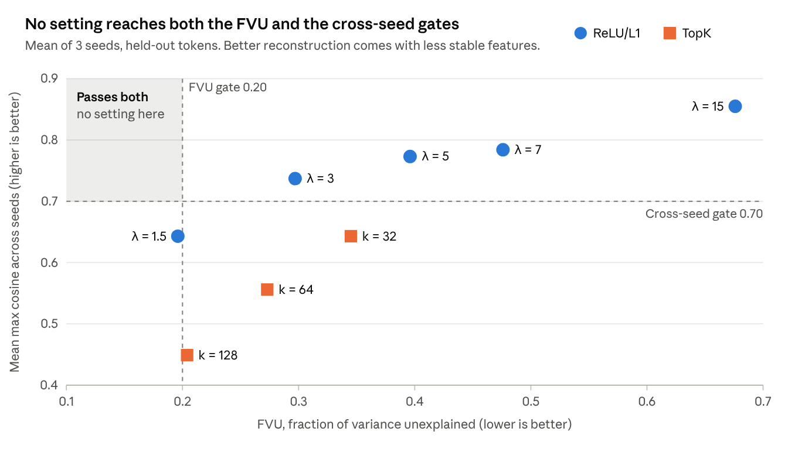

# Label-Blind Sparse Autoencoder Pilot on AgroNT Layer 13

Pilot report, deliverable D6 · 16 November 2026

**Status:** all pilot runs are complete. The setting carried forward and the final gate values are not yet frozen.

## Summary

Fifty-seven sparse autoencoders (SAEs) were trained on AgroNT layer 13 activations, using 103,343 corpus windows and no response label. They cover 19 settings, each with three seeds, across three architectures (ReLU/L1, TopK and BatchTopK) and three dictionary widths (4×, 8× and 16×).

No setting passes every fidelity gate as defined in the pilot protocol. The inactive-feature and always-on gates pass everywhere. FVU, masked-LM loss recovered and cross-seed stability work against one another: settings that rebuild layer 13 more faithfully have features that reproduce less well across seeds. BatchTopK with K = 128 is the only family to meet both the FVU and loss-recovered gates as written. Its features are the least stable of any setting.

## 1. Scope

The pilot fixes SAE training settings and pass/fail thresholds before any response label is joined to any activation (proposal §6.4). The proposal describes its gates as conventional starting points from the SAE literature, to be confirmed or revised by the pilot.

- **Label-blind.** The training and evaluation scripts read only activation stores and corpus windows. They never open Supplementary Data 6, the split file or any drought file.
- **The evaluation splits stay sealed.** No corpus gene, and no member of a corpus gene's homologue group, is in the discovery, development or confirmation split. Of the promoter component, 0 of 44,137 genes and 0 of 24,202 groups appear in the split file.
- **Deferred to D7.** Logit agreement, and comparison with PCA, ICA and raw neurons (§6.4).
- **Not covered.** Positive-control thresholds (§6.7). Those controls use evaluation-set promoters, whose activations have not been extracted.

## 2. Corpus

The corpus is 103,343 windows of 1,002 bp each (167 six-mer tokens), totalling 17,258,281 tokens. Every window is free of non-ACGT bases. The proposal names the region classes and the 80,000–150,000 window range (§6.2); the definitions and sizes below are this pilot's.

| Region class | Windows | Definition | Strand |
| --- | --- | --- | --- |
| Promoter | 44,137 | 1,002 bp upstream of the TSS | Gene |
| Intron | 9,204 | Centred in an intron of at least 1,002 bp, one per intron | Gene |
| 5′ UTR / TSS | 10,000 | Starts at the TSS of a gene with an annotated 5′ UTR, runs downstream | Gene |
| Splice | 10,000 | Centred on one exon–intron boundary, one per gene | Gene |
| Intergenic | 15,002 | At least 2 kb from any high- or low-confidence gene; matched to promoters on subgenome, TE fraction and GC | Reference + |
| Repeat | 15,000 | Inside one annotated repeat region at least 80% from one TE superfamily; at least 2 kb from any gene; allocated equally across superfamilies | Element |

- **Annotation.** Gene structure comes from the `.1` transcript of the IWGSC v1.1 high-confidence annotation. Repeats come from the IWGSC RefSeq v1.0 TE annotation.
- **Matching.** Intergenic windows differ from promoters by 0.004 SD in GC and 0.019 SD in TE fraction.
- **Repeat superfamilies.** Eight superfamilies supply about 1,858 windows each. Three rare ones (DTA, DHH, DTT) supply 131 between them.
- **Leakage control.** Genic classes draw only on genes outside the exclusion manifest. No window overlaps the body or 1,002 bp flanks of an evaluation gene or a member of its group. No window overlaps another corpus window, and no sequence appears twice among the new windows.

## 3. Methods

### 3.1 Activation site

Activations are the output of AgroNT `encoder.layer[12]`, equal to `hidden_states[13]`, chosen by the label-free motif probe in D4. Each token is a 1,500-dimensional vector, computed in float32 and stored in float16. AgroNT reads each window as one sequence with full bidirectional attention, so every token vector carries context from its whole window and from no other window.

### 3.2 Held-out data and normalisation

Ten per cent of homologue groups are held out (seed 20261105), with each group kept whole across region classes. This gives 10,349 held-out windows (1,728,283 tokens) and 15,529,998 training tokens. Every gate is measured on held-out tokens.

Inputs are centred on a per-dimension mean and multiplied by one global scale (0.4075), so that the mean squared norm is 1,500. Both constants come from training tokens only. The mean vector has norm 473, against a centred RMS norm of 95, so most of each raw vector is a shared offset.

### 3.3 Architectures

Every SAE encodes a token vector into a dictionary of features and rebuilds it:

```latex
f = \sigma\big(W_{enc}(x - b_{dec}) + b_{enc}\big), \qquad \hat{x} = W_{dec} f + b_{dec}
```

| Architecture | Sparsity mechanism (σ) | Loss | Decoder rows |
| --- | --- | --- | --- |
| ReLU/L1 | ReLU, with a penalty λ Σ fⱼ ‖W_dec,ⱼ‖ | Squared error + penalty | Unconstrained; start at length 0.1 |
| TopK | Keep the k largest pre-activations per token | Squared error | Held at unit length |
| BatchTopK | Training: keep the K × 4,096 largest activations across the batch, so K is the mean per token. Inference: keep activations above a learned threshold | Squared error | Held at unit length |

The BatchTopK threshold is a running average, at rate 0.001 per step, of the smallest activation kept in each training batch. It is stored with the model and used in every measurement, so each token's features do not depend on its batch.

### 3.4 Training

| Setting | Value |
| --- | --- |
| Widths | 4× (6,000 features), 8× (12,000), 16× (24,000) |
| Budget | 5 passes over the training tokens: 18,957 steps of 4,096 tokens |
| Optimiser | Adam, learning rate 2 × 10⁻⁴, gradient clip 1.0 |
| Schedule | Linear warm-up over 1% of steps; linear decay to zero over the last 20% |
| Initialisation | Encoder tied to the decoder at the start |
| Dead-feature resampling | None, so that the inactive rate is measured directly |
| Data order | Shards in a new random order each pass; tokens shuffled within groups of 8 shards |
| Precision | float32 weights and optimiser; TF32 matrix multiplies (Appendix B) |
| Seeds | 1, 2 and 3 for every setting |

**Settings trained**

| Architecture | Width | Settings |
| --- | --- | --- |
| ReLU/L1 | 4× | λ = 1.5, 3, 5, 7, 15 |
| TopK | 4× | k = 32, 64, 128 |
| ReLU/L1 | 8× | λ = 1.5, 2, 3 |
| ReLU/L1 | 16× | λ = 2, 3 |
| BatchTopK | 8× and 16× | K = 32, 64, 128 |

### 3.5 Measurements

| Measure | Definition | Starting gate (§6.4) |
| --- | --- | --- |
| L0 | Mean number of active features per held-out token | Reported |
| FVU | Summed squared error ÷ summed squared normalised input, over held-out tokens; also per region class | ≤ 0.20 |
| Loss recovered, as defined | (L_ablated − L_SAE) ÷ (L_ablated − L_original). 15% of real tokens are masked, with the same masks throughout, on 1,000 held-out windows (seed 20261106). The rebuild replaces layer 13 at every real token | ≥ 0.90 |
| Loss recovered, masked positions untouched | The same, but layer 13 is replaced only at unmasked tokens, because the SAEs never saw `<mask>` vectors in training. A diagnostic | None |
| Inactive features | Features that never fire on any held-out token | ≤ 20% of the dictionary |
| Always-on features | Features firing on more than 50% of held-out tokens | Flagged above 1% |
| Mean max cosine | For each feature, the highest decoder cosine to any feature of another seed, averaged over features and all ordered seed pairs | ≥ 0.70 |
| Stable in all 3 seeds | Seed 1 features with cosine ≥ 0.70 to some feature in each of the other two seeds | Reported |
| Converged | FVU on a fixed 65,536-token held-out sample improved by under 1% over the last pass of the constant learning-rate phase | Reported |

L_ablated replaces layer 13 with its training mean at the same positions. The original loss is 7.263. Mean ablation gives 8.469 at every real token, and 8.204 at unmasked tokens only.

### 3.6 Reproducibility

- **Scripts.** `scripts/build_corpus_regions.py` (seed 20261104), `scripts/train_sae.py` and `scripts/eval_sae.py`, with unit tests in `scripts/test_train_sae.py` and `scripts/test_eval_sae.py`.
- **Recorded versions.** Each run records the SHA-256 of the training script, the git commit, the environment and the store manifests in its `config.json`. ReLU/L1 and TopK runs used `train_sae.py` `e74d97b0…`; BatchTopK runs used `e0cd94bd…`, which adds BatchTopK without changing the other architectures.
- **Grids.** `docs/sae_pilot_grid.json`, `docs/sae_pilot_grid_8x.json`, `docs/sae_pilot_grid_16x.json` and `docs/sae_pilot_grid_batchtopk.json`.
- **Outputs.** `sae_pilot/`, with per-run weights, logs and configs; `summary.tsv`, `crossseed.json`, `loss_recovered.json` and `loss_recovered_unmasked.json`.
- **Restart safety.** Checkpoints of weights, optimiser and data position are written atomically every 2 minutes. A run force-killed twice on the GPU resumed to weights bit-identical to an uninterrupted run.
- **Environment.** Python 3.13.0, PyTorch 2.14.1+cu132, Transformers 4.46.3, NVIDIA RTX 4000 Ada (20 GB), Windows 11.
- **Cost.** Per run, about 9 minutes at 4×, 15–16 at 8× and 29–30 at 16×; about 16 GPU-hours in total. Storage is 64 GB, including 49 GB of activations.

## 4. Results

### 4.1 Gate outcomes

**Table 1. All settings.** Means of three seeds on held-out tokens. Median feature frequency is from seed 1. Values meeting a gate are in bold.

| Architecture | Width | Setting | L0 | Median feature frequency | FVU (≤ 0.20) | Loss recovered, as defined (≥ 0.90) | Loss recovered, masked positions untouched | Mean max cosine (≥ 0.70) | Stable in all 3 seeds | Max inactive (≤ 20%) | Converged seeds |
| --- | --- | --- | --- | --- | --- | --- | --- | --- | --- | --- | --- |
| ReLU/L1 | 4× | λ = 1.5 | 390 | 6.9% | **0.196** | 0.829 | **0.919** | 0.643 | 2,081 of 6,000 | **0.00%** | 3 of 3 |
| ReLU/L1 | 4× | λ = 3 | 159 | 2.8% | 0.297 | 0.708 | 0.862 | **0.737** | 2,931 of 6,000 | **0.00%** | 3 of 3 |
| ReLU/L1 | 4× | λ = 5 | 78 | 1.3% | 0.396 | 0.559 | not measured | **0.773** | 3,266 of 6,000 | **0.00%** | 3 of 3 |
| ReLU/L1 | 4× | λ = 7 | 46 | 0.79% | 0.476 | 0.438 | not measured | **0.784** | 3,440 of 6,000 | **0.00%** | 3 of 3 |
| ReLU/L1 | 4× | λ = 15 | 13 | 0.22% | 0.675 | 0.182 | not measured | **0.855** | 5,456 of 6,000 | **0.13%** | 3 of 3 |
| TopK | 4× | k = 32 | 32 | 0.32% | 0.345 | 0.782 | **0.910** (seed 1) | 0.643 | 2,135 of 6,000 | **0.10%** | 3 of 3 |
| TopK | 4× | k = 64 | 64 | 0.6% | 0.273 | 0.784 | **0.912** (seed 1) | 0.556 | 1,415 of 6,000 | **0.03%** | 3 of 3 |
| TopK | 4× | k = 128 | 128 | 0.96% | 0.204 | 0.874 | **0.943** | 0.449 | 795 of 6,000 | **0.00%** | 0 of 3 |
| ReLU/L1 | 8× | λ = 1.5 | 491 | 4.3% | **0.177** | 0.881 | **0.953** | 0.594 | 3,486 of 12,000 | **0.00%** | 3 of 3 |
| ReLU/L1 | 8× | λ = 2 | 332 | 2.9% | 0.215 | 0.862 | **0.941** | 0.647 | 4,231 of 12,000 | **0.00%** | 3 of 3 |
| ReLU/L1 | 8× | λ = 3 | 188 | 1.6% | 0.276 | 0.788 | **0.925** | **0.706** | 5,141 of 12,000 | **0.00%** | 3 of 3 |
| ReLU/L1 | 16× | λ = 2 | 389 | 1.7% | **0.200** | 0.894 | **0.979** | 0.609 | 7,068 of 24,000 | **0.00%** | 3 of 3 |
| ReLU/L1 | 16× | λ = 3 | 212 | 0.87% | 0.260 | 0.818 | **0.975** | 0.679 | 9,312 of 24,000 | **0.00%** | 3 of 3 |
| BatchTopK | 8× | K = 32 | 32 | 0.086% | 0.339 | 0.831 | **0.979** | 0.606 | 3,681 of 12,000 | **0.04%** | 2 of 3 |
| BatchTopK | 8× | K = 64 | 63 | 0.21% | 0.267 | 0.828 | **0.963** | 0.493 | 2,020 of 12,000 | **0.00%** | 2 of 3 |
| BatchTopK | 8× | K = 128 | 127 | 0.37% | **0.198** | **0.907** | **0.962** | 0.390 | 1,052 of 12,000 | **0.01%** | 2 of 3 |
| BatchTopK | 16× | K = 32 | 31 | 0.03% | 0.333 | 0.862 | **1.014** | 0.569 | 5,878 of 24,000 | **0.10%** | 2 of 3 |
| BatchTopK | 16× | K = 64 | 63 | 0.096% | 0.262 | 0.868 | **0.989** | 0.447 | 2,999 of 24,000 | **0.01%** | 2 of 3 |
| BatchTopK | 16× | K = 128 | 127 | 0.18% | **0.195** | **0.909** | **0.969** | 0.346 | 1,408 of 24,000 | **0.01%** | 2 of 3 |

The 4× TopK rows with k = 32 and 64 have the masked-positions-untouched value for seed 1 only. Per-seed values are in Appendix A.



*Figure 1. FVU against cross-seed stability for the 4× settings. Wider dictionaries and BatchTopK follow the same pattern (Table 1).*

### 4.2 By region class

**Table 2. FVU by region class.** Means of three seeds.

| Architecture | Width | Setting | Promoter | 5′ UTR / TSS | Splice | Intron | Intergenic | Repeat |
| --- | --- | --- | --- | --- | --- | --- | --- | --- |
| ReLU/L1 | 4× | λ = 1.5 | 0.201 | 0.185 | 0.200 | 0.204 | 0.201 | 0.176 |
| ReLU/L1 | 4× | λ = 3 | 0.304 | 0.281 | 0.306 | 0.309 | 0.305 | 0.264 |
| ReLU/L1 | 4× | λ = 5 | 0.404 | 0.376 | 0.411 | 0.412 | 0.408 | 0.350 |
| ReLU/L1 | 4× | λ = 7 | 0.486 | 0.452 | 0.496 | 0.496 | 0.492 | 0.422 |
| ReLU/L1 | 4× | λ = 15 | 0.687 | 0.637 | 0.705 | 0.704 | 0.699 | 0.604 |
| TopK | 4× | k = 32 | 0.356 | 0.332 | 0.363 | 0.362 | 0.356 | 0.286 |
| TopK | 4× | k = 64 | 0.282 | 0.260 | 0.285 | 0.286 | 0.282 | 0.230 |
| TopK | 4× | k = 128 | 0.211 | 0.193 | 0.211 | 0.214 | 0.211 | 0.175 |
| ReLU/L1 | 8× | λ = 1.5 | 0.182 | 0.168 | 0.182 | 0.184 | 0.182 | 0.155 |
| ReLU/L1 | 8× | λ = 2 | 0.221 | 0.204 | 0.221 | 0.224 | 0.221 | 0.187 |
| ReLU/L1 | 8× | λ = 3 | 0.283 | 0.263 | 0.286 | 0.288 | 0.285 | 0.238 |
| ReLU/L1 | 16× | λ = 2 | 0.206 | 0.192 | 0.207 | 0.209 | 0.206 | 0.170 |
| ReLU/L1 | 16× | λ = 3 | 0.268 | 0.250 | 0.271 | 0.272 | 0.269 | 0.218 |
| BatchTopK | 8× | K = 32 | 0.350 | 0.331 | 0.360 | 0.356 | 0.351 | 0.276 |
| BatchTopK | 8× | K = 64 | 0.276 | 0.258 | 0.281 | 0.280 | 0.276 | 0.223 |
| BatchTopK | 8× | K = 128 | 0.204 | 0.190 | 0.206 | 0.207 | 0.204 | 0.170 |
| BatchTopK | 16× | K = 32 | 0.345 | 0.327 | 0.355 | 0.351 | 0.345 | 0.263 |
| BatchTopK | 16× | K = 64 | 0.271 | 0.254 | 0.277 | 0.276 | 0.271 | 0.212 |
| BatchTopK | 16× | K = 128 | 0.202 | 0.187 | 0.204 | 0.204 | 0.202 | 0.163 |

### 4.3 Seed agreement

Seeds agree closely. Within a setting, FVU varies by about 0.005 at most and L0 by about 4 at most. Loss recovered varies more, by up to 0.046, which reflects the 25,000 masked tokens it rests on.

## 5. Observations

1. **No setting passes every gate as defined.** BatchTopK with K = 128 passes FVU and loss recovered at both widths (FVU 0.198 and 0.195; loss recovered 0.907 and 0.909). It fails the cross-seed gate by the widest margin (0.390 and 0.346). The only settings meeting the cross-seed mean of 0.70 are ReLU/L1 at λ ≥ 3 at 4×, and at λ = 3 at 8×, and none of those reaches FVU 0.20.

2. **Fidelity and stability trade off.** Within each architecture and width, allowing more active features per token improves FVU and generally loss recovered, but lowers the cross-seed mean. More active features per token give more ways for different seeds to divide up the same signal.

3. **Width mainly improves loss recovered and the stable-feature count.** At comparable L0, going from 4× to 16× raises loss recovered (masked positions untouched) from 0.919 to 0.979, and stable features from 2,081 to 7,068. FVU moves much less with width than with sparsity, and the cross-seed mean falls slightly.

4. **Architectures differ at matched sparsity.** At about 128 active features per token, TopK (4×) reaches FVU 0.204 and BatchTopK reaches 0.198 (8×) and 0.195 (16×), both with higher loss recovered than ReLU/L1 at similar FVU. ReLU/L1 gives the most stable features at a given L0. TopK and BatchTopK give the sparsest codes for a given FVU.

5. **Masked positions depress loss recovered.** Replacing layer 13 only at unmasked tokens raises loss recovered by 0.05–0.16 in every setting measured, and moves all but one of them (ReLU/L1 4×, λ = 3) above 0.90. Much of the shortfall under the protocol definition therefore comes from rebuilding `<mask>` vectors the SAEs never saw. The proposal's wording ("when the reconstruction is substituted") does not say which version is meant.

6. **The cross-seed gate can be read two ways.** §6.4 specifies "≥ 0.70 mean maximum cosine similarity for a matched feature; matched fraction reported", and §6.6.3 aggregates only features satisfying the cross-seed matching rule. Read as a gate on the whole dictionary, it fails at every high-fidelity setting. Read as a rule for which features count as matched, the stable-feature count becomes the quantity of interest. That count ranges from 795 to 9,312 across settings, against the 4,800 screened features assumed in §6.6.5.

7. **Inactive features are negligible when decoder rows start short.** No run exceeds 0.13% inactive features on held-out tokens, and none has an always-on feature. For ReLU/L1, starting decoder rows at length 1 left about 4,000 of 6,000 features never firing in a short test, against none at length 0.1 (Appendix B).

8. **Region classes rebuild almost equally.** Repeat windows rebuild best and introns worst in every setting. The spread is small: at ReLU/L1 4× λ = 1.5, FVU is 0.176 for repeats and 0.204 for introns. No class is poorly represented by the dictionary.

9. **Convergence.** Five passes is enough for every ReLU/L1 setting and for TopK at k = 32 and 64. TopK at k = 128 improved by 1.4–1.6% over its last constant-rate pass and is not converged. For every BatchTopK setting, seed 2 improved by 1.2–2.2% and is not converged; its final FVU is within 0.005 of the other seeds.

10. **A value above 1.** BatchTopK at 16× with K = 32 recovers 1.014 with masked positions untouched: a loss of 7.250 against the original 7.263. This is within what 25,000 masked tokens can resolve, and is not an improvement on the model.

11. **The corpus is sufficient for these widths.** With near-zero inactive features up to 24,000 features, there is no sign that 15.5 million training tokens are too few. The reserve of about 12,850 non-coding gene promoters (§6.4) is not needed.

12. **Limitations.**
    - Loss recovered rests on 1,000 windows, and its reference gap is 1.2 nats.
    - 5′ UTR windows lie mostly downstream of the UTR, because UTRs are short (median 121 bp).
    - Repeat copies cannot be screened against evaluation promoters by coordinate.
    - Ensembl non-coding genes (12,853 in the grouping) have no coordinates in the IWGSC files, so they could not be masked.
    - The promoter component holds 113 repeated sequences (44,024 distinct), which were kept.
    - Each window's first and last tokens have context on one side only.

13. **Not settled by this pilot.** The setting carried forward, and the final value and reading of each gate. The feature eligibility threshold (§6.6.3), which depends on that setting. The positive-control thresholds (§6.7).

## Appendix A. Per-seed results

| Architecture | Width | Setting | Seed | L0 | FVU | Loss recovered, as defined | Loss recovered, masked positions untouched | Inactive |
| --- | --- | --- | --- | --- | --- | --- | --- | --- |
| ReLU/L1 | 4× | λ = 1.5 | 1 | 390.1 | 0.1960 | 0.822 | 0.913 | 0.00% |
| ReLU/L1 | 4× | λ = 1.5 | 2 | 389.0 | 0.1960 | 0.827 | 0.919 | 0.00% |
| ReLU/L1 | 4× | λ = 1.5 | 3 | 390.1 | 0.1960 | 0.838 | 0.924 | 0.00% |
| ReLU/L1 | 4× | λ = 3 | 1 | 159.4 | 0.2968 | 0.733 | 0.866 | 0.00% |
| ReLU/L1 | 4× | λ = 3 | 2 | 159.3 | 0.2966 | 0.687 | 0.870 | 0.00% |
| ReLU/L1 | 4× | λ = 3 | 3 | 159.7 | 0.2968 | 0.704 | 0.850 | 0.00% |
| ReLU/L1 | 4× | λ = 5 | 1 | 77.4 | 0.3960 | 0.553 | — | 0.00% |
| ReLU/L1 | 4× | λ = 5 | 2 | 77.7 | 0.3956 | 0.554 | — | 0.00% |
| ReLU/L1 | 4× | λ = 5 | 3 | 77.6 | 0.3959 | 0.571 | — | 0.00% |
| ReLU/L1 | 4× | λ = 7 | 1 | 46.0 | 0.4767 | 0.435 | — | 0.00% |
| ReLU/L1 | 4× | λ = 7 | 2 | 46.2 | 0.4760 | 0.421 | — | 0.00% |
| ReLU/L1 | 4× | λ = 7 | 3 | 46.1 | 0.4764 | 0.456 | — | 0.00% |
| ReLU/L1 | 4× | λ = 15 | 1 | 13.2 | 0.6756 | 0.177 | — | 0.02% |
| ReLU/L1 | 4× | λ = 15 | 2 | 13.1 | 0.6750 | 0.162 | — | 0.00% |
| ReLU/L1 | 4× | λ = 15 | 3 | 13.1 | 0.6758 | 0.205 | — | 0.13% |
| TopK | 4× | k = 32 | 1 | 32.0 | 0.3449 | 0.775 | 0.910 | 0.07% |
| TopK | 4× | k = 32 | 2 | 32.0 | 0.3448 | 0.801 | — | 0.08% |
| TopK | 4× | k = 32 | 3 | 32.0 | 0.3446 | 0.772 | — | 0.10% |
| TopK | 4× | k = 64 | 1 | 64.0 | 0.2728 | 0.794 | 0.912 | 0.00% |
| TopK | 4× | k = 64 | 2 | 64.0 | 0.2732 | 0.777 | — | 0.00% |
| TopK | 4× | k = 64 | 3 | 64.0 | 0.2730 | 0.779 | — | 0.03% |
| TopK | 4× | k = 128 | 1 | 128.0 | 0.2042 | 0.885 | 0.945 | 0.00% |
| TopK | 4× | k = 128 | 2 | 128.0 | 0.2042 | 0.885 | 0.951 | 0.00% |
| TopK | 4× | k = 128 | 3 | 128.0 | 0.2043 | 0.851 | 0.933 | 0.00% |
| ReLU/L1 | 8× | λ = 1.5 | 1 | 490.3 | 0.1769 | 0.879 | 0.950 | 0.00% |
| ReLU/L1 | 8× | λ = 1.5 | 2 | 490.6 | 0.1767 | 0.884 | 0.959 | 0.00% |
| ReLU/L1 | 8× | λ = 1.5 | 3 | 491.2 | 0.1768 | 0.879 | 0.949 | 0.00% |
| ReLU/L1 | 8× | λ = 2 | 1 | 331.9 | 0.2147 | 0.847 | 0.942 | 0.00% |
| ReLU/L1 | 8× | λ = 2 | 2 | 332.1 | 0.2145 | 0.890 | 0.948 | 0.00% |
| ReLU/L1 | 8× | λ = 2 | 3 | 332.6 | 0.2147 | 0.848 | 0.932 | 0.00% |
| ReLU/L1 | 8× | λ = 3 | 1 | 187.7 | 0.2758 | 0.789 | 0.927 | 0.00% |
| ReLU/L1 | 8× | λ = 3 | 2 | 188.1 | 0.2755 | 0.779 | 0.925 | 0.00% |
| ReLU/L1 | 8× | λ = 3 | 3 | 188.2 | 0.2757 | 0.797 | 0.923 | 0.00% |
| ReLU/L1 | 16× | λ = 2 | 1 | 387.9 | 0.2000 | 0.878 | 0.983 | 0.00% |
| ReLU/L1 | 16× | λ = 2 | 2 | 389.4 | 0.1998 | 0.899 | 0.981 | 0.00% |
| ReLU/L1 | 16× | λ = 2 | 3 | 389.4 | 0.1999 | 0.905 | 0.974 | 0.00% |
| ReLU/L1 | 16× | λ = 3 | 1 | 211.9 | 0.2602 | 0.837 | 0.981 | 0.00% |
| ReLU/L1 | 16× | λ = 3 | 2 | 212.5 | 0.2600 | 0.824 | 0.983 | 0.00% |
| ReLU/L1 | 16× | λ = 3 | 3 | 212.9 | 0.2601 | 0.794 | 0.960 | 0.00% |
| BatchTopK | 8× | K = 32 | 1 | 31.6 | 0.3391 | 0.836 | 0.978 | 0.03% |
| BatchTopK | 8× | K = 32 | 2 | 32.1 | 0.3372 | 0.832 | 0.978 | 0.00% |
| BatchTopK | 8× | K = 32 | 3 | 31.0 | 0.3418 | 0.825 | 0.983 | 0.04% |
| BatchTopK | 8× | K = 64 | 1 | 63.2 | 0.2682 | 0.820 | 0.968 | 0.00% |
| BatchTopK | 8× | K = 64 | 2 | 64.4 | 0.2653 | 0.814 | 0.952 | 0.00% |
| BatchTopK | 8× | K = 64 | 3 | 62.3 | 0.2689 | 0.849 | 0.969 | 0.00% |
| BatchTopK | 8× | K = 128 | 1 | 127.2 | 0.1983 | 0.905 | 0.958 | 0.01% |
| BatchTopK | 8× | K = 128 | 2 | 129.0 | 0.1972 | 0.911 | 0.962 | 0.01% |
| BatchTopK | 8× | K = 128 | 3 | 125.9 | 0.1994 | 0.906 | 0.965 | 0.01% |
| BatchTopK | 16× | K = 32 | 1 | 31.5 | 0.3324 | 0.851 | 1.013 | 0.10% |
| BatchTopK | 16× | K = 32 | 2 | 32.0 | 0.3305 | 0.855 | 1.011 | 0.05% |
| BatchTopK | 16× | K = 32 | 3 | 30.7 | 0.3356 | 0.880 | 1.019 | 0.07% |
| BatchTopK | 16× | K = 64 | 1 | 62.9 | 0.2618 | 0.868 | 1.001 | 0.01% |
| BatchTopK | 16× | K = 64 | 2 | 64.2 | 0.2596 | 0.869 | 0.981 | 0.01% |
| BatchTopK | 16× | K = 64 | 3 | 61.5 | 0.2645 | 0.867 | 0.986 | 0.00% |
| BatchTopK | 16× | K = 128 | 1 | 126.6 | 0.1950 | 0.906 | 0.968 | 0.01% |
| BatchTopK | 16× | K = 128 | 2 | 128.8 | 0.1937 | 0.914 | 0.967 | 0.01% |
| BatchTopK | 16× | K = 128 | 3 | 124.7 | 0.1968 | 0.906 | 0.972 | 0.00% |

## Appendix B. Configuration checks

These used the 65,536-token held-out monitoring sample, seed 1 unless noted, at 6,000 steps.

**Starting length of ReLU/L1 decoder rows, λ = 5**

| Variant | FVU | L0 | Never fired |
| --- | --- | --- | --- |
| Length 1 | 0.458 | 54.8 | 4,016 |
| Length 1, L1 warm-up over 5% of steps | 0.454 | 56.4 | 3,928 |
| Length 0.1 | 0.401 | 85.6 | 0 |
| Length 0.1, L1 warm-up over 5% of steps | 0.399 | 85.4 | 0 |

**λ against sparsity, 4×, length 0.1**

| λ | L0 | FVU | Never fired |
| --- | --- | --- | --- |
| 2 | 288 | 0.238 | 0 |
| 3 | 172 | 0.301 | 0 |
| 5 | 86 | 0.401 | 0 |
| 7 | 53 | 0.483 | 0 |
| 10 | 33 | 0.576 | 0 |
| 15 | 21 | 0.682 | 9 |

**Numerical precision, ReLU/L1 4×, λ = 5.** TF32 was accepted because its difference from float32 is smaller than the spread across seeds.

| Run | FVU | L0 | Never fired |
| --- | --- | --- | --- |
| TF32, seed 1 | 0.40128 | 85.628 | 0 |
| TF32, seed 2 | 0.40103 | 85.982 | 0 |
| TF32, seed 3 | 0.40059 | 85.497 | 0 |
| float32, seed 1 | 0.40136 | 85.628 | 0 |

The float32–TF32 difference (0.00008 in FVU, 0.0003 in L0) is below the seed spread (0.00069 and 0.485). TF32 took 155 s against 272 s.

## References

- Bricken, T., et al. (2023). Towards Monosemanticity: Decomposing Language Models With Dictionary Learning. Transformer Circuits Thread. https://transformer-circuits.pub/2023/monosemantic-features
- Cunningham, H., Ewart, A., Riggs, L., Huben, R. & Sharkey, L. (2023). Sparse Autoencoders Find Highly Interpretable Features in Language Models. arXiv:2309.08600.
- Mendoza-Revilla, J., et al. (2024). A foundational large language model for edible plant genomes. Communications Biology, 7(1), 835.
- FYP Proposal, Revision 6, §§5.3, 6.2–6.7.
- Pilot protocol: `docs/sae_pilot_protocol.md`.
