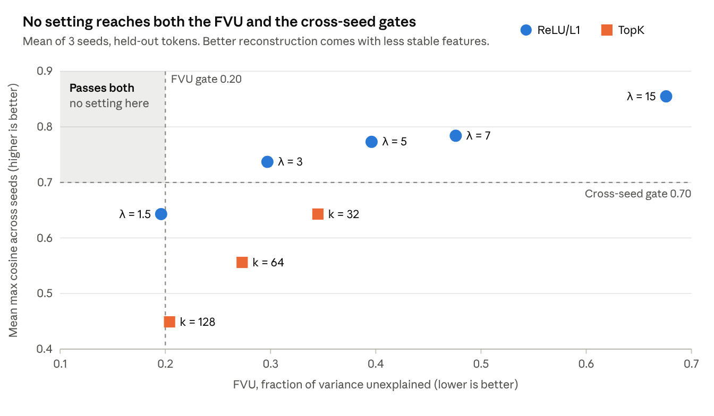

# Label-Blind Sparse Autoencoder Pilot on AgroNT Layer 13

Pilot report, deliverable D6

6 November 2026 · Kumail

**Status: draft for supervisor review. Gates are not yet frozen.**

## 1. Summary

No tested setting passes every fidelity gate as the pilot protocol defined them, so the gates and the setting carried forward need a supervisor decision before they are frozen.

Twenty-four sparse autoencoders (SAEs) were trained on AgroNT layer 13, across eight settings with three seeds each, using 103,343 corpus windows and no response label. The inactive-feature and always-on gates pass at every setting. Fraction of variance unexplained (FVU), masked-LM loss recovered and cross-seed stability pull against one another: settings that rebuild the layer better have less stable features.

Two issues of interpretation affect this outcome, and both arose after results were seen:

- **Loss recovered.** The test replaced `<mask>` vectors that the SAE never trained on. Leaving those positions untouched raises loss recovered at λ = 1.5 from 0.829 to 0.919.
- **Cross-seed matching.** The proposal's wording can be read as a gate on the whole dictionary or as a rule for which features count as matched.

**Recommendation.** Carry forward ReLU/L1 at λ = 1.5, adopting both readings, with no numerical threshold lowered. It then passes every gate, with 2,081 features stable across all three seeds. Its limitation is density, at 390 active features per token. Because both readings were chosen after seeing results, this report states that openly and asks for the supervisor's judgement (Section 7). Later 8× tests (Section 4.6) show a strong alternative at λ = 1.5, which needs an amendment to §5.3.

## 2. Purpose and scope

The pilot fixes the SAE training settings and pass/fail thresholds before any response label is joined to any activation (proposal §6.4, deliverable D6). The proposal's gates are “conventional starting points drawn from the sparse autoencoder literature rather than measurements on this model”, and the pilot confirms or revises each.

**Label blindness.** The training and evaluation scripts read only activation stores and corpus windows. They do not open Supplementary Data 6, the split file or any drought file.

**The discovery split remains sealed.** None of the 44,137 promoter-component genes or their 24,202 homologue groups appear in the split file. The new region classes draw only on genes outside the evaluation set and its groups.

**Out of scope.** Logit agreement and comparison with PCA, ICA and raw neurons (§6.4) are deferred to D7. Positive-control thresholds (§6.7) remain open, as described in Section 8.

## 3. Methods

### 3.1 Activation site

Activations are the output of AgroNT `encoder.layer[12]`, equal to `hidden_states[13]`, selected by the motif probe in D4. Each 1,002 bp window gives 167 six-mer tokens, each a 1,500-dimensional vector computed in float32 and stored in float16.

### 3.2 Corpus

The corpus is 103,343 windows and 17,258,281 tokens, within the 80,000–150,000 windows of §6.2. The proposal names the region classes but not their definitions or sizes, so those below are decisions of this pilot.

| Region class | Windows | Definition | Strand |
| --- | --- | --- | --- |
| Promoter | 44,137 | Upstream of the TSS, from the existing corpus | Gene |
| Intron | 9,204 | Centred in an intron of at least 1,002 bp, one per intron | Gene |
| 5′ UTR / TSS | 10,000 | Starts at the TSS of a gene with an annotated 5′ UTR, runs downstream | Gene |
| Splice | 10,000 | Centred on one exon–intron boundary, one per gene | Gene |
| Intergenic | 15,002 | At least 2 kb from any high- or low-confidence gene; matched to promoters on subgenome, TE fraction and GC | Reference + |
| Repeat | 15,000 | Inside one annotated repeat region at least 80% from one TE superfamily; at least 2 kb from any gene; allocated equally across superfamilies | Element |

The gene structure comes from the `.1` transcript of the IWGSC v1.1 annotation. Matched intergenic windows differ from promoters by 0.004 SD in GC and 0.019 SD in TE fraction. Eight repeat superfamilies supply about 1,858 windows each; three rare ones (DTA, DHH, DTT) supply 131 between them.

**Leakage control.** Genic classes use only genes absent from the exclusion manifest. No window overlaps the body or 1,002 bp flanks of an evaluation gene or a member of its group. No new window overlaps another corpus window or repeats a sequence already in the corpus. All windows are free of non-ACGT bases.

### 3.3 Held-out data and normalisation

Ten per cent of homologue groups were held out with seed 20261105, keeping each group whole across classes. This gives 10,349 held-out windows (1,728,283 tokens) and 15,529,998 training tokens. All gates are measured on held-out windows.

Inputs are centred on a fixed per-dimension mean and multiplied by one global scale (0.4075), so that the mean squared norm equals 1,500. Both constants come from training windows only. Centring matters here: the mean vector has norm 473, while the centred RMS norm is 95.

### 3.4 Architecture and training

Each SAE reads one token vector, encodes it into 6,000 features (4× expansion, §6.4) and rebuilds the 1,500-dimensional input.

```latex
f = \mathrm{ReLU}\big(W_{enc}(x - b_{dec}) + b_{enc}\big), \qquad \hat{x} = W_{dec} f + b_{dec}
```

ReLU/L1 runs add a penalty λ Σ fⱼ ‖W_dec,ⱼ‖ to the squared reconstruction error. TopK runs keep the k largest activations and hold decoder rows at unit norm.

| Setting | Value |
| --- | --- |
| Grid | ReLU/L1 at λ = 1.5, 3, 5, 7, 15; TopK at k = 32, 64, 128; seeds 1, 2, 3 |
| Budget | 5 passes: 18,957 steps of 4,096 tokens |
| Optimiser | Adam, learning rate 2×10⁻⁴, gradient clip 1.0 |
| Schedule | Linear warm-up over 1% of steps, linear decay to 0 over the last 20% |
| Initialisation | Encoder tied to decoder at the start; ReLU decoder rows start at length 0.1 |
| Dead-feature resampling | None, so that the inactive rate is measured directly |
| Precision | float32 weights; TF32 matrix multiplies, accepted in a pre-registered check against float32 |

### 3.5 Measurements

| Measure | Definition | Starting gate (§6.4) |
| --- | --- | --- |
| FVU | Summed squared error ÷ summed squared normalised input, over held-out tokens | ≤ 0.20 |
| Loss recovered | (L_ablated − L_SAE) ÷ (L_ablated − L_original) with 15% of tokens masked, the same masks throughout, on 1,000 held-out windows | ≥ 0.90 |
| Inactive features | Never fire on any held-out token | ≤ 0.20 of dictionary |
| Always-on features | Fire on more than 50% of held-out tokens | Flagged above 0.01 |
| Cross-seed matching | For each feature, the highest decoder cosine to any feature of another seed, averaged over all ordered seed pairs | Mean ≥ 0.70 |

L_ablated replaces layer 13 with its mean vector. A feature counts as matched at cosine ≥ 0.70.

## 4. Results

### 4.1 Gate outcomes

Every setting fails at least one gate as the protocol defined them. Table 1 gives means of three seeds on 1,728,283 held-out tokens, with passing values in bold. Per-seed values are in Appendix A.

**Table 1. Gate outcomes by setting**

| Setting | Active features per token (L0) | FVU (≤ 0.20) | Loss recovered (≥ 0.90) | Mean max cosine (≥ 0.70) | Matched, pairwise | Stable in all 3 seeds | Inactive (≤ 0.20) | Always-on (≤ 0.01) |
| --- | --- | --- | --- | --- | --- | --- | --- | --- |
| ReLU/L1, λ = 1.5 | 390 | **0.196** | 0.829 | 0.643 | 43% | 2,081 | **0** | **0** |
| ReLU/L1, λ = 3 | 159 | 0.297 | 0.708 | **0.737** | 58% | 2,931 | **0** | **0** |
| ReLU/L1, λ = 5 | 78 | 0.396 | 0.559 | **0.773** | 63% | 3,266 | **0** | **0** |
| ReLU/L1, λ = 7 | 46 | 0.476 | 0.438 | **0.784** | 66% | 3,440 | **0** | **0** |
| ReLU/L1, λ = 15 | 13 | 0.676 | 0.182 | **0.855** | 95% | 5,456 | **0.0005** | **0** |
| TopK, k = 32 | 32 | 0.345 | 0.783 | 0.643 | 44% | 2,135 | **0.0008** | **0** |
| TopK, k = 64 | 64 | 0.273 | 0.784 | 0.556 | 31% | 1,415 | **0.0001** | **0** |
| TopK, k = 128 | 128 | 0.204 | 0.874 | 0.449 | 20% | 795 | **0** | **0** |

“Stable in all 3 seeds” counts seed 1 features with cosine ≥ 0.70 to some feature in both other seeds, out of 6,000.



*Figure 1. Fidelity against stability. Source: `sae_pilot/summary.tsv` and `crossseed.json`, 24 runs.*

Seeds agree closely on FVU (within 0.001) and L0 (within 1.2). Loss recovered varies more, by up to 0.046 within a setting.

### 4.2 Observations

- **Region classes.** FVU is similar across classes. Repeat windows rebuild best and introns worst: 0.176 and 0.204 at λ = 1.5, and 0.175 and 0.214 at k = 128.
- **Feature frequency.** Passing FVU has a cost in sparsity. At λ = 1.5 the median feature fires on 6.9% of tokens, against 1.0% at k = 128.
- **ReLU/L1 against TopK.** TopK recovers more loss at comparable FVU: k = 32 has FVU 0.345 and recovers 0.783, while λ = 3 has FVU 0.297 and recovers 0.708. L1 shrinkage of activations is a plausible cause but was not tested. ReLU/L1 is more stable across seeds at comparable L0.

### 4.3 Convergence

FVU was compared across the final pass of the constant learning-rate phase, with convergence defined as an improvement below 1%. All ReLU/L1 runs and TopK at k = 32 and 64 converged. TopK at k = 128 did not, improving by 1.4–1.6%, and would need extending if carried forward. Five passes is sufficient for the other settings.

### 4.4 Corpus sufficiency

The corpus is sufficient for a 6,000-feature dictionary on the evidence measured. No run exceeds 0.13% inactive features on held-out data, so the reserve of about 12,850 non-coding gene promoters (§6.4) is not needed.

### 4.5 Restart safety

Two forced process terminations during a real GPU run resumed to weights bit-identical to an uninterrupted run. The grid was also interrupted once during the pilot, and resumed from its checkpoint with logged values reproduced exactly at step 13,000. This satisfies the resumability requirement of §6.3.

### 4.6 Tests of an 8× dictionary

ReLU/L1 was also trained at 12,000 features with three seeds and the same settings. λ = 3 ran first, with a criterion stated in advance: 8× would be preferred if FVU reached about 0.20 with cross-seed at or above 0.70 and loss recovered near 0.90. FVU reached only 0.276, so that criterion was not met. λ = 2 and 1.5 were added after seeing that result, to test whether FVU 0.20 is reachable at this width.

**Table 3. 8× settings against the 4× settings**

| Measure (mean of 3 seeds) | 4×, λ = 1.5 | 4×, λ = 3 | 8×, λ = 1.5 | 8×, λ = 2 | 8×, λ = 3 |
| --- | --- | --- | --- | --- | --- |
| Features | 6,000 | 6,000 | 12,000 | 12,000 | 12,000 |
| Active features per token (L0) | 390 | 159 | 491 | 332 | 188 |
| Median feature frequency, seed 1 | 6.9% | 2.8% | 4.3% | 2.9% | 1.6% |
| FVU (≤ 0.20) | **0.196** | 0.297 | **0.177** | 0.215 | 0.276 |
| Loss recovered, as defined (≥ 0.90) | 0.829 | 0.708 | 0.881 | 0.862 | 0.789 |
| Loss recovered, masked positions untouched | **0.919** | 0.862 | **0.953** | **0.941** | **0.925** |
| Mean max cosine (≥ 0.70) | 0.643 | **0.737** | 0.594 | 0.647 | **0.706** |
| Stable in all 3 seeds | 2,081 | 2,931 | 3,486 | 4,231 | 5,141 |
| Inactive features | **0** | **0** | **0** | **0** | **0** |

No 8× setting reaches both the FVU gate and the dictionary-wide cross-seed mean, so the trade-off in Section 4.1 persists at this width. At λ = 1.5, 8× improves on 4× in FVU, loss recovered under both definitions, stable features (68% more) and median feature frequency. It is worse in active features per token (491 against 390) and in the cross-seed mean (0.594 against 0.643). All 8× runs converged, at about 15.6 minutes per run. Only λ = 3 at 8× has more stable features than the 4,800 assumed in §6.6.5.

## 5. Issues of interpretation

Both issues below determine whether any setting passes, and both were identified after the results were seen. They are reported as such, and neither has been adopted.

### 5.1 Masked positions in the loss-recovered test

The test substituted x̂ at every real token, including the 15% replaced by `<mask>`. The SAEs trained on stored activations from unmasked sequences, so `<mask>` vectors lie outside their training data. A diagnostic repeated the measurement with masked positions left untouched. Mean ablation at those same positions gives a loss of 8.204, against 8.469 in the protocol measurement. The original loss is 7.263 in both.

**Table 2. Loss recovered under each definition**

| Setting | Seeds measured in diagnostic | As defined in the protocol | Masked positions untouched (diagnostic) |
| --- | --- | --- | --- |
| ReLU/L1, λ = 1.5 | 3 | 0.829 | **0.919** |
| ReLU/L1, λ = 3 | 3 | 0.708 | 0.862 |
| TopK, k = 32 | 1 (seed 1) | 0.775 | **0.910** |
| TopK, k = 64 | 1 (seed 1) | 0.794 | **0.912** |
| TopK, k = 128 | 3 | 0.874 | **0.943** |

Single-seed rows show the seed 1 value in both columns. A substantial part of the shortfall therefore comes from rebuilding `<mask>` vectors, not from losing information at real tokens. The proposal's wording, “when the reconstruction is substituted”, does not settle which version is meant.

### 5.2 Wording of the cross-seed gate

§6.4 specifies “≥ 0.70 mean maximum cosine similarity for a matched feature; matched fraction reported”, and §6.6.3 aggregates “only features satisfying the predeclared cross-seed matching rule”. Two readings are possible:

| Reading | Meaning | Consequence |
| --- | --- | --- |
| Dictionary gate (as written in the pilot protocol, and tested in Table 1) | The mean over all features must reach 0.70 | Only λ = 3, 5, 7 and 15 pass |
| Per-feature rule | 0.70 decides which features count as matched; the matched fraction is reported, not gated | No setting fails; the number of stable features becomes the quantity of interest |

If the per-feature reading is adopted, the power analysis needs revisiting. §6.6.5 assumes 4,800 features screened in discovery, and only λ = 15 at 4× and λ = 3 at 8× (Section 4.6) have more stable features than that.

## 6. Deviations and limitations

### 6.1 Deviations from the pilot protocol

| # | Deviation | Reason |
| --- | --- | --- |
| 1 | λ = 1.5 added to the 4 planned values, giving 24 runs rather than 21. The protocol said the λ scan would look only at L0, but FVU was visible in the same output | Every value in the planned span was well above the 0.20 FVU gate in short runs |
| 2 | Loss recovered measured on all 24 runs, not only the best setting of each type | No setting passed the other gates, so no “best” was defined |
| 3 | Masked-position diagnostic added (Section 5.1) | Investigating the loss-recovered shortfall |
| 4 | ReLU decoder rows start at length 0.1, a setting not in the protocol's first draft; adopted in the smoke test, before the grid | At length 1, about 4,000 of 6,000 features never fired in a short run at λ = 5; at length 0.1, none did |

### 6.2 Departures from the proposal

- Windows are 1,002 bp, not 1 kb, as recorded in D4, so that each is exactly 167 six-mers.
- The promoter component is 44,137 windows, against 45,119 in §6.4, because windows with non-ACGT bases are removed.
- TopK also uses three seeds. §6.4 names three seeds only for the ReLU/L1 baseline.
- The region-class definitions and sizes in Section 3.2 are not specified in the proposal.
- The 8× tests in Section 4.6 go beyond §5.3, which withdrew scale tests.

### 6.3 Limitations

- **Loss recovered** rests on 1,000 windows and 25,000 masked tokens, and the gap it is measured against is 1.2 nats (7.263 to 8.469).
- **5′ UTR windows** are mostly downstream of the UTR itself, because UTRs are short (median 121 bp).
- **Repeat copies** cannot be screened against evaluation promoters by coordinate, so similar TE copies may occur in both.
- **Ensembl non-coding genes** (12,853 in the grouping) have no coordinates in the IWGSC annotation files, so they could not be masked.
- **Duplicate sequences.** The promoter store holds 113 repeated sequences (44,024 distinct), which were retained.
- **Pilot numbers are not D7 results.** D7 must still train and evaluate the frozen setting.

## 7. Options and recommendation

The proposal allows the pilot to revise each gate, and the pilot protocol requires any revision to rest on a measured property of the data and to be reported beside the original value.

| Option | Setting | What changes | Result | Principal concern |
| --- | --- | --- | --- | --- |
| **A (recommended)** | ReLU/L1, λ = 1.5 | Loss recovered measured at unmasked positions; cross-seed read as a per-feature rule. No threshold lowered | FVU 0.196; recovered 0.919; 2,081 stable features | Least sparse option: 390 active features per token |
| B | TopK, k = 128, trained longer | The same two readings; more training | Recovered 0.943; 795 stable features; FVU 0.204, not yet shown to reach 0.20 | Fewest stable features |
| C | ReLU/L1, λ = 3 | FVU gate raised to about 0.30; loss-recovered gate also lowered, or the two readings adopted as well | L0 159; 2,931 stable features; recovered 0.862 | Thresholds lowered after seeing results |
| D | None | All gates kept as defined | “No setting in the grid passes” (§7.3): features reported descriptively only; the representation question passes to the linear probe | Limits the feature-level work planned for FYP 2 |
| E | ReLU/L1, λ = 1.5, 8× dictionary (12,000 features) | The same two readings as A; amendment to §5.3, which withdrew scale tests as “narrow question; not required by any core outcome” | FVU 0.177; recovered 0.953; 3,486 stable features | Added after seeing results; highest L0 tested (491); lowest cross-seed mean of the ReLU/L1 settings (0.594); twice as many features to screen |

**Why A is recommended.** It is the only setting that reaches the FVU gate, and it does so without lowering any numerical threshold. It also has more stable features than the other high-fidelity option, TopK at k = 128. It needs no amendment to §5.3, and has the lowest L0 of the settings that reach the FVU gate. Option E is the strongest alternative: it beats A on FVU, loss recovered and stable features, and its features fire less often, at the costs listed above.

**The case against A.** Both readings were chosen after the gates failed, which is the kind of post-hoc flexibility the pilot exists to prevent. No response label was involved, so this cannot have favoured any drought result, but a reader may still treat it with caution. At 390 active features per token, individual features may also be harder to interpret.

### Decisions requested from the supervisor

1. Which option should be carried forward?
2. Is the masked-position definition of loss recovered acceptable as the gate measurement?
3. Should the cross-seed criterion be a dictionary gate or a per-feature rule?
4. Should the 8× dictionary (option E) be adopted instead of A, with an amendment to §5.3?

## 8. Open items and reproducibility

### 8.1 Open items before D6 is complete

- [ ] Freeze the setting and gate values, after the decisions in Section 7.
- [ ] Set the feature eligibility threshold (§6.6.3), which depends on the setting chosen.
- [ ] Set the positive-control thresholds (§6.7). Those controls use evaluation-set promoters, whose activations have not been extracted, and how to obtain them label-blind needs its own decision.

### 8.2 Reproducibility record

| Item | Value |
| --- | --- |
| Repository base commit | `53bc99f` holds the pilot code and matches the hashes below. Run configs record `abd0348`, because the runs predate the commit |
| `scripts/train_sae.py`, grid version | SHA-256 `e74d97b0072473e2…`, recorded in each run's `config.json` |
| `scripts/eval_sae.py` | SHA-256 `0818f22eb87926b1…`, changed since `53bc99f` to keep dictionary widths separate in cross-seed matching |
| `scripts/build_corpus_regions.py` | SHA-256 `b4f7836630c42bb8…`; seed 20261104 |
| New-window content hash | `564adbfb7e3297f0` |
| Seeds | Held-out split 20261105; loss-recovered masks 20261106; SAE seeds 1, 2, 3 |
| Activation stores | `activations/L13/` (promoters), `activations/regions/L13/` (new classes), manifests hashed |
| Outputs | `sae_pilot/`: per-run weights, logs and configs; `summary.tsv`; `crossseed.json`; `loss_recovered.json`; `loss_recovered_unmasked.json` |
| Protocol | `docs/sae_pilot_protocol.md`; grids in `docs/sae_pilot_grid.json` and `docs/sae_pilot_grid_8x.json` |
| Tests | `scripts/test_train_sae.py` and `scripts/test_eval_sae.py`, passing |
| Environment | Python 3.13.0, PyTorch 2.14.1+cu132, Transformers 4.46.3, NVIDIA RTX 4000 Ada (20 GB), Windows 11 |
| Compute | About 8.8 minutes per run, about 3.5 hours for the 4× grid; about 2.3 hours for the 8× runs; 58 GB of storage |

## Appendix A. Per-seed results

| Run | L0 | FVU | Loss recovered | Inactive |
| --- | --- | --- | --- | --- |
| λ = 1.5, seed 1 | 390.1 | 0.1960 | 0.822 | 0 |
| λ = 1.5, seed 2 | 389.0 | 0.1960 | 0.827 | 0 |
| λ = 1.5, seed 3 | 390.1 | 0.1960 | 0.838 | 0 |
| λ = 3, seed 1 | 159.4 | 0.2968 | 0.733 | 0 |
| λ = 3, seed 2 | 159.3 | 0.2966 | 0.687 | 0 |
| λ = 3, seed 3 | 159.7 | 0.2968 | 0.704 | 0 |
| λ = 5, seed 1 | 77.4 | 0.3960 | 0.553 | 0 |
| λ = 5, seed 2 | 77.7 | 0.3956 | 0.554 | 0 |
| λ = 5, seed 3 | 77.6 | 0.3959 | 0.571 | 0 |
| λ = 7, seed 1 | 46.0 | 0.4767 | 0.435 | 0 |
| λ = 7, seed 2 | 46.2 | 0.4760 | 0.421 | 0 |
| λ = 7, seed 3 | 46.1 | 0.4764 | 0.456 | 0 |
| λ = 15, seed 1 | 13.2 | 0.6756 | 0.178 | 0.0002 |
| λ = 15, seed 2 | 13.1 | 0.6750 | 0.162 | 0 |
| λ = 15, seed 3 | 13.1 | 0.6758 | 0.205 | 0.0013 |
| k = 32, seed 1 | 32 | 0.3450 | 0.775 | 0.0007 |
| k = 32, seed 2 | 32 | 0.3448 | 0.801 | 0.0008 |
| k = 32, seed 3 | 32 | 0.3446 | 0.772 | 0.0010 |
| k = 64, seed 1 | 64 | 0.2728 | 0.794 | 0 |
| k = 64, seed 2 | 64 | 0.2732 | 0.778 | 0 |
| k = 64, seed 3 | 64 | 0.2730 | 0.779 | 0.0003 |
| k = 128, seed 1 | 128 | 0.2042 | 0.885 | 0 |
| k = 128, seed 2 | 128 | 0.2042 | 0.885 | 0 |
| k = 128, seed 3 | 128 | 0.2043 | 0.851 | 0 |

Inactive values are rounded to four decimals, so a 0 may hide a very small non-zero rate.

## Appendix B. Smoke-test results

These were fixed before the grid, on the 65,536-token monitoring sample, at 6,000 steps with seed 1 unless noted. They are not gate measurements.

**Starting decoder length, λ = 5.**

| Variant | FVU | L0 | Never fired |
| --- | --- | --- | --- |
| Decoder rows start at length 1 | 0.458 | 54.8 | 4,016 |
| Length 1, L1 warm-up over 5% of steps | 0.454 | 56.4 | 3,928 |
| Length 0.1 | 0.401 | 85.6 | 0 |
| Length 0.1, L1 warm-up over 5% of steps | 0.399 | 85.4 | 0 |

**λ scan, starting length 0.1.**

| λ | L0 | FVU | Never fired |
| --- | --- | --- | --- |
| 2 | 288 | 0.238 | 0 |
| 3 | 172 | 0.301 | 0 |
| 5 | 86 | 0.401 | 0 |
| 7 | 53 | 0.483 | 0 |
| 10 | 33 | 0.576 | 0 |
| 15 | 21 | 0.682 | 9 |

**Numerical precision, λ = 5.** The acceptance rule, set in advance, was that float32 and TF32 must differ by less than the spread across seeds.

| Run | FVU | L0 | Never fired |
| --- | --- | --- | --- |
| TF32, seed 1 | 0.40128 | 85.628 | 0 |
| TF32, seed 2 | 0.40103 | 85.982 | 0 |
| TF32, seed 3 | 0.40059 | 85.497 | 0 |
| float32, seed 1 | 0.40136 | 85.628 | 0 |

The float32 difference (0.00008 in FVU, 0.0003 in L0) is below the seed spread (0.00069 and 0.485), so TF32 was accepted. Its run time was 155 s against 272 s.

## References

- Bricken, T., et al. (2023). Towards Monosemanticity: Decomposing Language Models With Dictionary Learning. Transformer Circuits Thread. [Link](https://transformer-circuits.pub/2023/monosemantic-features)
- Cunningham, H., Ewart, A., Riggs, L., Huben, R. & Sharkey, L. (2023). Sparse Autoencoders Find Highly Interpretable Features in Language Models. [arXiv:2309.08600](https://arxiv.org/abs/2309.08600)
- Mendoza-Revilla, J., et al. (2024). A foundational large language model for edible plant genomes. Communications Biology, 7(1), 835.
- FYP Proposal, Revision 6, §§5.3, 6.2–6.7, 7.3, 9.
- Pilot protocol: `docs/sae_pilot_protocol.md`.
